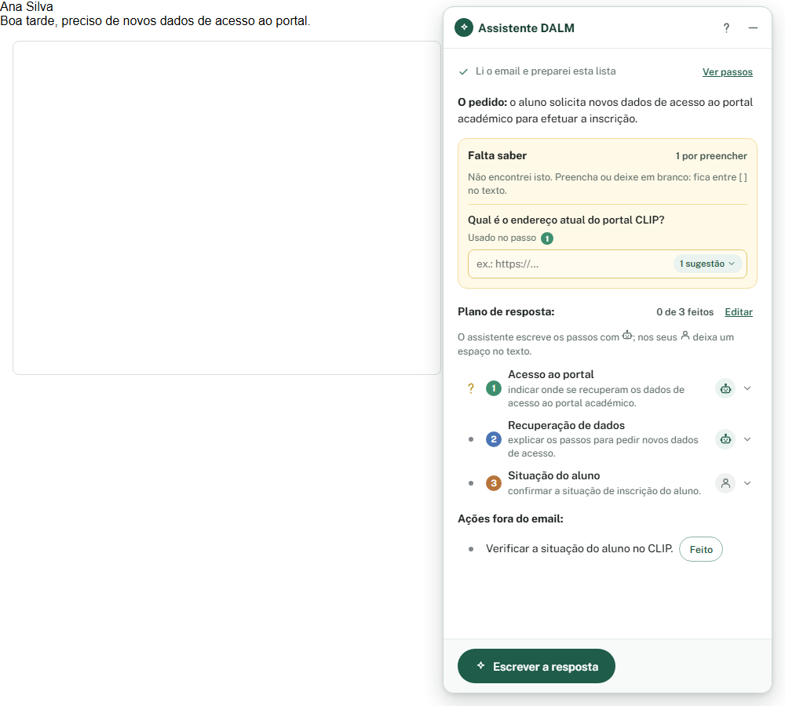
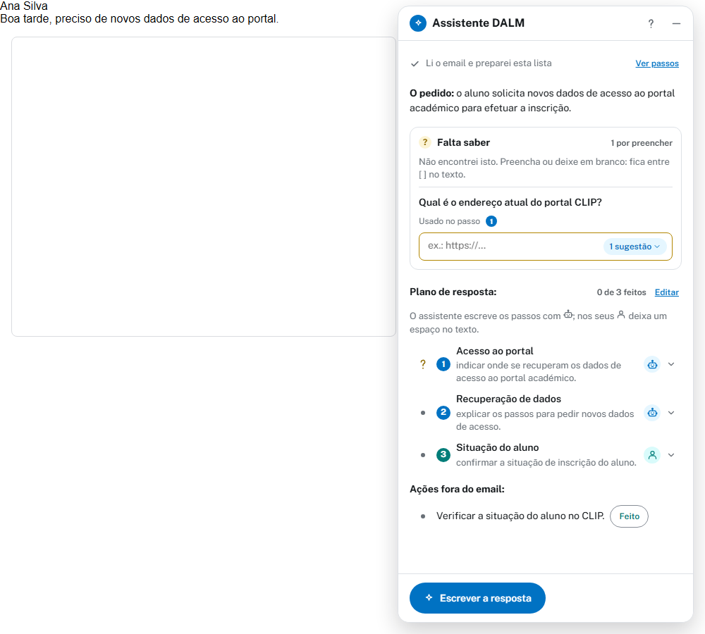
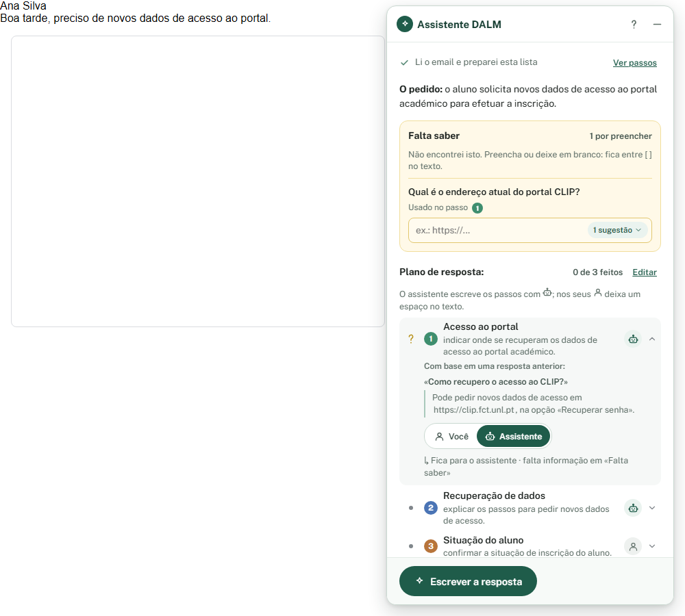
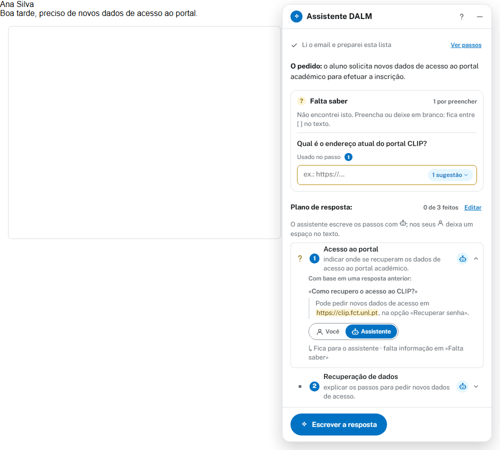

# Assistente DALM: design kit

Status: **applied** (2026-10-20): IBM palette, white as the only 60, cyan for the assistant and teal for the person. The tokens live at the top of `UI_CSS` in `public/content.js`; use them and do not add raw values. Sections 1–2 describe the panel *before* the kit; section 6 has the results after it.

## 1. Audit: what the panel used before the kit

Counted from `UI_CSS`, with `var()`s resolved:

| Property | Distinct values | Notes |
|---|---|---|
| Colours | **39** | 7 near-white neutrals (#FFF, #F7FAF8, #F6F8F7, #F3F6F4, #F1F4F2, #EEF1EF, #F2F7F4); 9 shadow colours |
| Border styles | **11** | 6 border colours, widths 1 / 1.5 / 2 px, 2 dashed variants |
| Corner radii | **13** | 3, 6, 8, 9, 10, 12, 13, 14, 16, 18, 20, 22 px, 50% |
| Font sizes | **11** | 10, 11, 11.5, 12, 12.5, 13, 13.5, 14, 14.5, 15, 19 px |
| Paddings | **30** | |
| Gaps | **10** | 1, 2, 3, 4, 6, 8, 10, 12, 14 px |
| Control heights | **9** | 24, 30, 32, 34, 36, 38, 40, 44 px |
| Shadows | **9** | |

The values grew one component at a time. A kit needs about a quarter of them.

## 2. Measurements

### 2.1 Colour roles (60-30-10)

The real panel was rendered in headless Chrome (sample plan with one "Falta saber" value, three steps, one outside task) and every pixel of the docked panel was classified by lightness and saturation.

| Role | Target | List state | One step opened |
|---|---|---|---|
| Dominant: neutral surface | 60 % | **71.2 %** | 68.8 % |
| Secondary: tinted surfaces, text, lines | 30 % | **25.4 %** | 27.1 % |
| Accent: saturated colour | 10 % | **3.4 %** | 4.1 % |

What the numbers hide:
- **17.4 % of the panel is amber**: the "Falta saber" box. The largest secondary colour is the *warning* colour, not the brand's. The secondary role should be the brand green, with amber reserved for small signals.
- **The accent is mostly one button**: "Escrever a resposta" (#1F5C4A, 2.2 %). Everything else accented is tiny (step numbers, icons).
- **The neutral share is high** because the panel is mostly white with no structure (header and footer barely differ from the body).

### 2.2 Contrast (WCAG 2.2 AA)

**8 of 24 pairs fail:**

| Pair | Ratio | Needs |
|---|---|---|
| Placeholder / hint text (#80868B) on white | 3.68 | 4.5 |
| Placeholder on amber field (#FFFBEF) | 3.56 | 4.5 |
| Pending progress step (#A3ADA8) | 2.31 | 4.5 |
| Amber "?" icon (#B8921C) | 2.93 | 3 |
| Amber field border (#E2C76E) | 1.58 | 3 |
| Edit-field border (#C4CDC8) | 1.63 | 3 |
| Panel border (#C9D8D0) | 1.48 | 3 (it also has a shadow, so this one is optional) |
| Você/Assistente toggle border (#C9D8D0) | 1.48 | 3 |

The rest pass, including body text (15.8:1), links and the primary button (7.8:1) and the tooltip (12.3:1).

## 3. The kit

### 3.1 Colour roles (IBM Design Language palette)

All colours come from IBM's palette, as published in Carbon's `@carbon/colors` package (v11.60, checked 2026-10-20). Contrast was computed for every pairing below. The only failure is white text on Cyan 50 (3.33:1), which is why filled buttons use Cyan 60.

There are **two accents**, one per author: **cyan for the assistant**, **teal for the person**. Where a colour marks *who* writes something (a step, its number, its bar in the email, a ✓), it is the author's colour.

**60: white**

| Token | Value | Use |
|---|---|---|
| `--surface` | white `#ffffff` | the only surface: panel, header, body, footer, fields, cards |

**30: Cool Gray (text and structure)**

| Token | IBM | Value | Use | Contrast on white |
|---|---|---|---|---|
| `--ink` | Cool Gray 100 | `#121619` | titles, body text | 18.2 |
| `--ink-2` | Cool Gray 70 | `#4d5358` | secondary text | 7.8 |
| `--ink-3` | Cool Gray 60 | `#697077` | hints, placeholders, captions | 5.0 (≥4.5 on every tint) |
| `--field-line` | Cool Gray 50 | `#878d96` | edges of fields, toggles, secondary buttons | 3.3 (≥3.0 on every tint) |
| `--line` | Cool Gray 20 | `#dde1e6` | dividers, card and panel edges (decorative) | 1.3 |
| `--hover` | Cool Gray 10 | `#f2f4f8` | hover and pressed states only; never a resting surface | |

**10: accents**

| Token | IBM | Value | Use | Contrast |
|---|---|---|---|---|
| `--ai` | Cyan 50 | `#1192e8` | assistant: icons, step numbers, email bars, selected toggle | 3.3 on white (UI ≥3) |
| `--ai-strong` | Cyan 60 | `#0072c3` | assistant: main button fill, links, text | 5.0; white on it 5.0 |
| `--ai-tint` | Cyan 10 | `#e5f6ff` | small assistant highlights (badge, hover of a step, the open step) | |
| `--you` | Teal 50 | `#009d9a` | person: icons, step numbers, email bars | 3.3 on white |
| `--you-strong` | Teal 60 | `#007d79` | person: text and filled controls | 5.0; white on it 5.0 |
| `--you-tint` | Teal 10 | `#d9fbfb` | small person highlights | |

**Signals (not accents, used sparingly)**

| Token | IBM | Value | Use | Contrast |
|---|---|---|---|---|
| `--warn` | Yellow 60 | `#8e6a00` | "?" icon and text about missing information | 5.0 |
| `--warn-line` | Yellow 50 | `#b28600` | edge of a field still missing its value | 3.3 |
| `--warn-bg` / `--warn-ink` | Yellow 10 / 70 | `#fcf4d6` / `#684e00` | only the `[ ]` blank highlight | 7.1 |
| `--danger` | Red 60 | `#da1e28` | delete ⊖ | 5.0 |
| `--focus` | Blue 60 | `#0f62fe` | focus ring (IBM's own focus colour) | 5.0 |

**Rules:**
- A colour that isn't white or gray means something: cyan "the assistant", teal "you", yellow "missing", red "delete", blue "focused".
- Bright grade 50 for shapes (icons, numbers, bars, edges); grade 60 for text and filled buttons.
- Tints (grade 10) are small highlights, never large surfaces, so white stays the 60.

### 3.2 Borders (one system)

| Token | Value | Use |
|---|---|---|
| `--border` | `1px solid var(--line)` | cards, dividers, panel edge, menus |
| `--border-field` | `1px solid var(--field-line)` | inputs, text boxes, toggles, secondary buttons |
| `--border-warn` | `1px solid var(--warn-line)` (Yellow 50) | a field still missing its value |
| `--border-empty` | `1.5px dashed var(--field-line)` | **only** "something goes here": empty slot ring, new-step number |
| Focus | `2px solid var(--focus)`, offset 2px | every focusable control |

No other widths. No coloured borders except warn.

### 3.3 Radii

| Token | Value | Use |
|---|---|---|
| `--r-xs` | 4px | inline marks (`[ ]` highlight, source highlight) |
| `--r-sm` | 8px | fields, small buttons, menu items, tooltips |
| `--r-md` | 12px | cards ("Falta saber"), menus, opened step, ready card |
| `--r-lg` | 16px | the panel |
| `--r-full` | 999px | pills, round buttons, badge, step numbers |

That's 13 radii down to 5.

### 3.4 Spacing (4px grid)

`--s-1` 4 · `--s-2` 8 · `--s-3` 12 · `--s-4` 16 · `--s-5` 24. Gaps and paddings use only these: half-steps (1, 2, 3, 6, 10, 14 px) go. Panel padding 16; card padding 12; gap between sections 16; gap inside a row 8.

### 3.5 Type scale

| Token | Size / weight | Use |
|---|---|---|
| `--t-title` | 16 / 700 | panel title, guide title |
| `--t-body` | 14 / 400 | request, step titles (600), questions (600), section headings (700), field text |
| `--t-small` | 13 / 400 | descriptions, hints, buttons in rows |
| `--t-caption` | 12 / 600 | counters, captions, tooltips, pills |
| `--t-micro` | 10 / 700 | only numbers inside 16px circles (small step numbers, badge count) |

11 sizes down to 5 (the guide's 19 → 16). Weights 400 / 600 / 700. The step numbers drawn over the email (`drawMarks`) sit outside the shadow root and repeat the 10px value inline.

### 3.6 Control heights

`--h-sm` 32 (row buttons, toggles, pills) · `--h-md` 40 (fields, secondary buttons) · `--h-lg` 44 (primary button). 9 heights down to 3. 32 stays below section 8's 40–44 target, as already recorded in HANDOFF 14.2.

### 3.7 Elevation

| Token | Use |
|---|---|
| `--e-1` `0 1px 3px rgba(18,22,25,.14)` | badge, pills |
| `--e-2` `0 6px 16px rgba(18,22,25,.16)` | menus, dropdowns, tooltips |
| `--e-3` `0 12px 32px rgba(18,22,25,.20)` | panel, guide, ready card (dragging adds nothing new) |

The shadow colour is Cool Gray 100. 9 shadows down to 3 (plus the focus ring and two inset edges, which the audit counts as shadows).

## 4. Changes to reach 60-30-10

1. **White becomes the only surface.** The "Falta saber" box loses its amber fill (17 % of the panel today) and becomes a white card with a Cool Gray 20 edge; yellow stays only on the "?", the `[ ]` blank and the edge of a field still missing its value. Footer and opened steps lose their near-white fills (the 7 near-whites go).
2. **Structure comes from Cool Gray**, not from tinted fills: one divider colour, one field-edge colour, three text greys.
3. **The dark green brand colour is replaced by the two author accents**: cyan for everything the assistant does (main button, badge, its steps, its bars in the email), teal for the person (their steps, slots and bars).
4. **Expected result:** white ~85–90 % / Cool Gray (text, lines, edges) ~7–10 % / accents ~3–5 %. Note that with white as the only surface, the 30 is mostly text and lines, so it is measured as *everything gray*, and white will exceed 60 % in a text-light panel like this one; 60-30-10 is then read as "white dominates, gray structures, colour only marks meaning".

## 5. How it's checked

Three checks, rerun after any visual change:
1. **Audit**: count the distinct values per property in `UI_CSS`, with `var()`s resolved.
2. **Contrast**: the WCAG 2.2 ratio of every text/background and control/background pair the panel uses (4.5 for text, 3 for controls).
3. **60-30-10**: render the real `content.js` in headless Chrome (same sample plan as before) and classify every pixel of the docked panel: near-white = 60, gray (text, lines, edges) = 30, saturated = 10.

The scripts currently live outside the repo.

## 6. Results (2026-10-20)

### 6.1 60-30-10

| Role | Target | Before (list) | After (list) | After (one step opened) |
|---|---|---|---|---|
| White | ≥60 % | 71.2 % | **88.6 %** | **86.7 %** |
| Gray: text, lines, edges | ~30 % | 25.4 % (17.4 % of it amber) | **8.3 %** | **9.5 %** |
| Accent: cyan, teal, yellow | ≤10 % | 3.4 % | **3.0 %** | **3.8 %** |

As predicted in section 4: with white as the only surface, white dominates, gray only structures, and colour stays under 4 %. The amber block (17 % of the panel) is gone; yellow is now only the "?", the empty field's edge and the `[ ]` highlights.

### 6.2 Audit

| Property | Before | After |
|---|---|---|
| Colours | 39 | **24** |
| Border styles | 11 | **7** |
| Corner radii | 13 | **5** |
| Font sizes | 11 | **5** |
| Paddings | 30 | **22** |
| Gaps | 10 | **5** |
| Control heights | 9 | **6** |
| Shadows | 9 | **5** |

The remaining paddings are combinations of the spacing tokens (e.g. `8px 12px`), not new values. The remaining heights are the three control heights plus fixed sizes for icons and step numbers.

### 6.3 Contrast

Before: **8 of 24** pairs failed. After: **0 of 28** fail WCAG 2.2 AA.

### 6.4 Screenshots

| | Before | After |
|---|---|---|
| List |  |  |
| One step opened |  |  |

### 6.5 Colour of a step

A step's colour is its author: cyan if the assistant writes it, teal if the person does. The same colour marks its number in the panel, its bar in the email and its ✓. Two adjacent assistant steps therefore share a colour in the email. To tell them apart, each bar has the step's number beside it (`drawMarks`), so the email and the plan still match one to one. This replaces the earlier one-colour-per-step `PALETTE`, which put up to six colours on the email at once.
